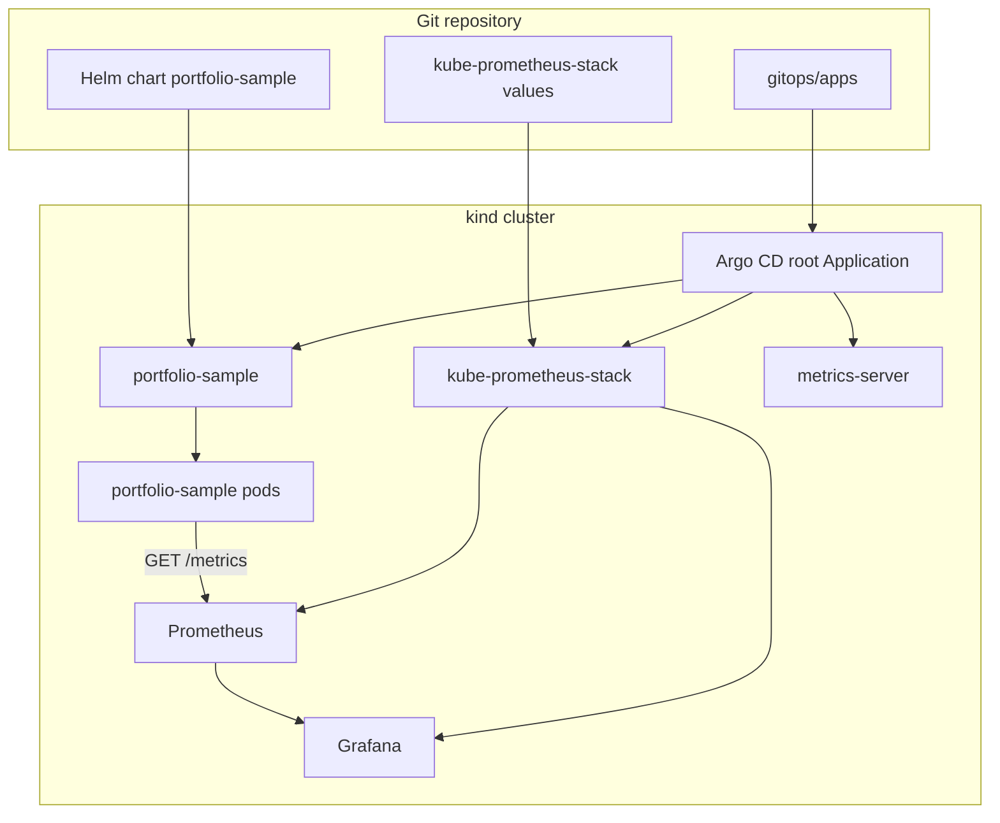
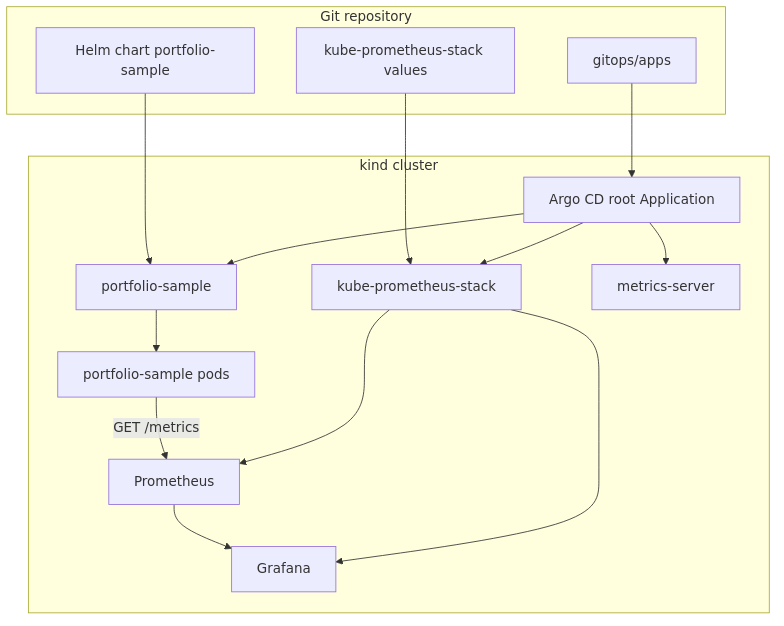
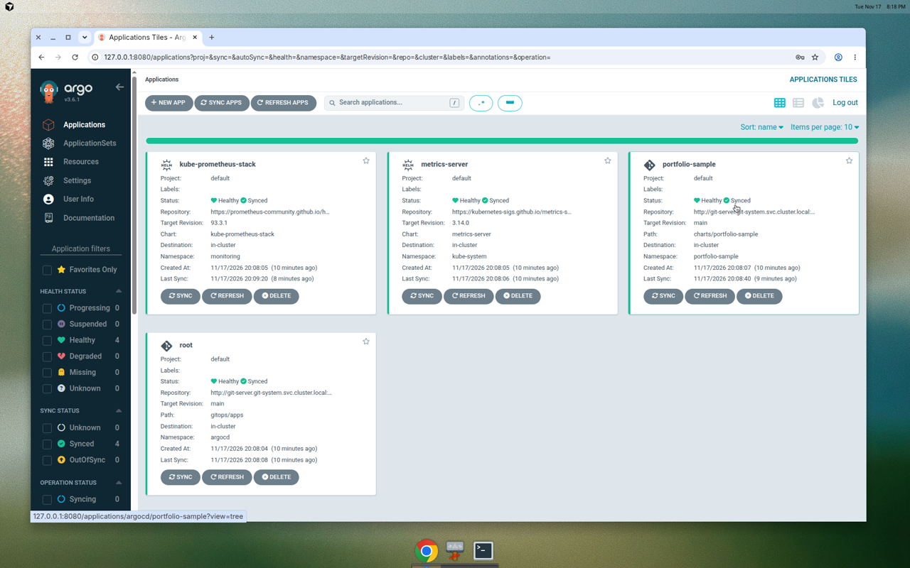
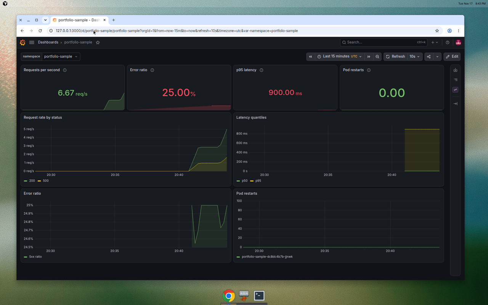
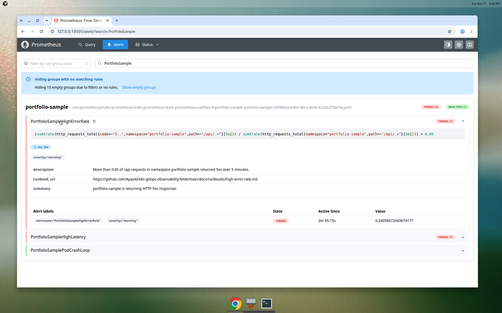

# k8s-gitops-observability

[](https://github.com/AyazAI/k8s-gitops-observability/actions/workflows/ci.yml)

Kubernetes, GitOps, and observability sample for Muhammad Ayaz.

**No live demo: runs locally on kind.** Nothing in this repository is deployed to a cloud account. The screenshots are from a local kind cluster.

## Problem

A small HTTP service is only useful as a portfolio piece if the repository also shows how it is packaged, rolled out, and watched. This repo is that path:

1. A Go service exposes `/healthz`, `/readyz`, and Prometheus `/metrics`.
2. A Helm chart runs it as a non-root, read-only container with probes, an HPA, a PodDisruptionBudget, a ServiceMonitor, and PrometheusRule alerts.
3. Argo CD applies an app-of-apps from Git.
4. kube-prometheus-stack scrapes the service and shows rate, errors, latency, and restarts in Grafana.

There are no production users, no traffic numbers from a live system, and no claim that this chart is running anywhere except a local kind cluster.

## Architecture





## Stack

Versions are pinned in `scripts/versions.env`.

| Piece | Role |
| --- | --- |
| Go HTTP service | `/healthz`, `/readyz`, `/metrics`, sample `/api/echo` and `/api/error` |
| Helm | Chart in `charts/portfolio-sample` with `values-dev.yaml` and `values-prod.yaml` |
| kind | Local cluster, node image `kindest/node:v1.35.8` |
| Argo CD | App-of-apps from `gitops/` |
| kube-prometheus-stack | Prometheus, Grafana, Alertmanager, node-exporter, kube-state-metrics |
| metrics-server | CPU metrics for the HPA |
| Loki chart | Optional manifest only. The default bootstrap does not install it |
| Terraform | EKS-shaped sketch under `infra/`. Not applied |

CI builds the container image and does not push it. kind loads `portfolio-sample:dev` into the node.

## Repository layout

```text
app/                         Go service, Dockerfile, unit tests
charts/portfolio-sample/     Helm chart, dev/prod values, dashboard, alerts
gitops/apps/                 Argo CD Applications (the app-of-apps children)
gitops/root-app.yaml         Root Application
gitops/platform/             kube-prometheus-stack values
gitops/optional/             Loki Application, not installed by the root app
deploy/kind/                 In-cluster git server used only by the local bootstrap
kind/cluster.yaml            kind cluster config
infra/terraform/eks/         Terraform sketch. fmt and validate only
docs/runbooks/               Alert notes
docs/screenshots/            Captures from the local kind run
.github/workflows/ci.yml     Lint, test, image build, kubeconform, gitleaks, kind smoke
```

## Run it locally on kind

Install Docker, kind, kubectl, Helm, and Python 3. The script uses `sudo` only when `iptables-legacy` has a DROP policy on FORWARD, which otherwise blocks egress from the kind bridge. From a checkout:

```bash
make kind-bootstrap
```

That command:

1. Creates the kind cluster from `kind/cluster.yaml` if it does not exist.
2. Builds `portfolio-sample:dev` and loads it into the node. The image is not pulled from a registry.
3. Installs Argo CD and turns on `--insecure` so a port-forward can use HTTP. This is only done on the local cluster.
4. Generates a Grafana admin password and stores it in the Secret `grafana-admin-credentials` in the `monitoring` namespace. The chart values point at that Secret. The password is not written into Git.
5. Mirrors the working tree to a git server inside the cluster and applies the root Application against that mirror.

The mirror exists because the committed Applications track `https://github.com/AyazAI/k8s-gitops-observability.git` at `main`, and a private repository on an unmerged branch cannot be fetched by Argo CD without credentials. The mirror rewrites the repo URL only inside the cluster. The files committed here keep the GitHub URL.

After the Applications are Synced:

```bash
make port-forward
make print-passwords
make traffic
```

`make print-passwords` reads the Argo CD password from `argocd-initial-admin-secret` and the Grafana password from `grafana-admin-credentials`.

| UI | URL | User |
| --- | --- | --- |
| Argo CD | http://127.0.0.1:8080 | admin, password from the Secret |
| Grafana | http://127.0.0.1:3000 | admin, password from the Secret |
| Prometheus | http://127.0.0.1:9090 | no login |
| Service | http://127.0.0.1:18080 | `/healthz`, `/metrics`, `/api/echo`, `/api/error` |

`make traffic` calls `/api/echo`, `/api/echo?sleep_ms=800`, and `/api/error` for three minutes. `/api/error` always returns 500 so the error ratio and latency panels have real samples. `sleep_ms` is capped at 2000.

Grafana dashboard uid is `portfolio-sample`.

Tear the cluster down with `make kind-down`.

`make kind-smoke` is the smaller check used by CI: it installs only the workload (ServiceMonitor and PrometheusRule off, because those CRDs come from kube-prometheus-stack) and curls `/healthz` and `/metrics`.

`make kind-loki` applies `gitops/optional/loki.yaml`. That Application is not part of `gitops/apps`, and this repo does not install a log collector.

### GitHub mode

After this repository is public and `main` contains the charts:

```bash
GITOPS_MODE=github make kind-bootstrap
```

That applies `gitops/root-app.yaml` as committed. If the repository is still private, export `GITHUB_TOKEN` in the shell first. The script creates a repository Secret from that variable and does not write the token into Git.

## How the GitOps flow works

`gitops/root-app.yaml` is an Argo CD Application whose source path is `gitops/apps`. Argo CD applies every Application in that directory:

| Application | Source | Sync wave |
| --- | --- | --- |
| metrics-server | metrics-server chart 3.14.0, with `--kubelet-insecure-tls` for kind | 0 |
| kube-prometheus-stack | chart 93.3.1 plus the values in `gitops/platform/kube-prometheus-stack/` | 0 |
| portfolio-sample | `charts/portfolio-sample` with `values.yaml` and `values-dev.yaml` | 1 |

The portfolio-sample namespace is labeled `pod-security.kubernetes.io/enforce=restricted`. The pod runs as UID 65532, drops all capabilities, and uses a read-only root filesystem. An emptyDir is mounted at `/tmp`.

Prometheus selects every ServiceMonitor and PrometheusRule (`ruleSelectorNilUsesHelmValues: false` and the same for ServiceMonitors). The ServiceMonitor scrapes the Service port named `http` at `/metrics` every 15 seconds.

`values-kind.yaml` is included by the Application because the cluster this repo runs is one kind node. It lowers requests, keeps six hours of Prometheus data, and turns off Grafana's default dashboards. Raise those requests before using the same values on a larger cluster. They are not production sizing.

## Alerts

| Alert | Pending for | Condition | Severity | Runbook |
| --- | --- | --- | --- | --- |
| PortfolioSampleHighErrorRate | 2m | 5xx ratio on `/api` over 5m is above 5% | warning | [high-error-rate.md](docs/runbooks/high-error-rate.md) |
| PortfolioSampleHighLatency | 2m | p95 `/api` latency over 5m is above 0.5s | warning | [high-latency.md](docs/runbooks/high-latency.md) |
| PortfolioSamplePodCrashLoop | 2m | a container in the release namespace is in CrashLoopBackOff | critical | [pod-crashloop.md](docs/runbooks/pod-crashloop.md) |

The application metrics are `http_requests_total` (`method`, `path`, `code`) and `http_request_duration_seconds` (`method`, `path`). Prometheus adds `namespace` when it scrapes. The crash loop alert uses `kube_pod_container_status_waiting_reason` from kube-state-metrics. Calls to `/metrics` are not counted.

## Screenshots

These three captures are from the local kind cluster created by `make kind-bootstrap` on this checkout. They are not from a shared or hosted environment.



`root`, `kube-prometheus-stack`, `metrics-server`, and `portfolio-sample` were Synced and Healthy. The repository field in that UI is the in-cluster git mirror, not GitHub. The committed manifests still use the GitHub URL and `targetRevision: main`.



`make traffic` was calling `/api/echo`, `/api/echo?sleep_ms=800`, and `/api/error`. The stat row on this capture read 6.67 requests/s, a 25% error ratio, 900 ms p95, and 0 pod restarts.



`PortfolioSampleHighErrorRate` and `PortfolioSampleHighLatency` were firing. The error-rate alert value shown was about 0.25. `PortfolioSamplePodCrashLoop` was inactive because the pod was not crash-looping.

## Checks

`make ci` runs formatting, `go vet`, unit tests, Helm lint (including a render of the optional Loki values and the metrics-server chart), `kubeconform -strict` against the Kubernetes 1.35 schemas and the datree CRD catalog, yamllint, `terraform fmt -check`, and `terraform validate`. `make docker-smoke` builds the image and runs it with a read-only root filesystem, UID 65532, and all capabilities dropped. `make gitleaks` scans the tree.

GitHub Actions is defined in `.github/workflows/ci.yml`. The kind job is the same smoke test. Terraform in CI does not run `plan` or `apply`.

## Terraform

`infra/terraform/eks` is a minimal EKS-shaped configuration: a cluster IAM role, a cluster, a node IAM role, and a node group. `subnet_ids` defaults to an empty list. See [infra/README.md](infra/README.md). Do not run `terraform apply`.

## License

[MIT](LICENSE). Copyright (c) 2026 Muhammad Ayaz.
